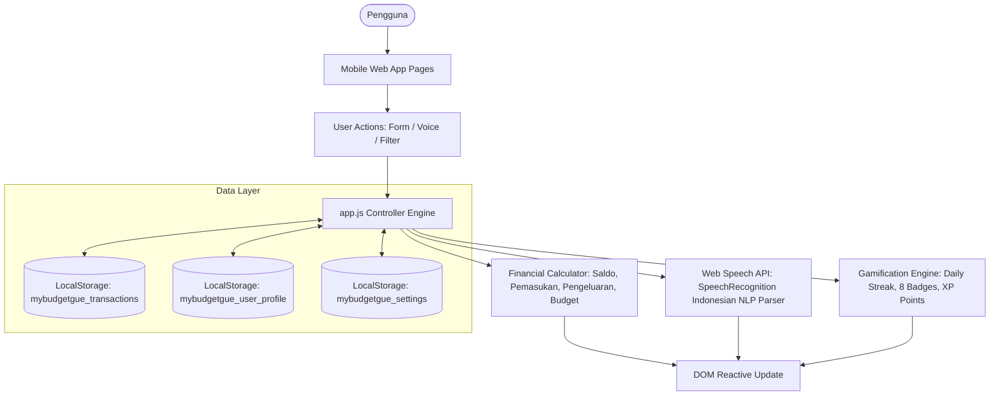

# Arsitektur Frontend MyBudgetGue

Aplikasi MyBudgetGue dibangun dengan arsitektur **Client-side Single State Controller (LocalStorage Driven)** murni berbasis HTML5 Semantic, Tailwind CSS, dan Vanilla JavaScript tanpa backend server.

---

## 🏛️ Diagram Alur Data & State Flow

---

## 🔑 Skema Kunci Penyimpanan (LocalStorage Keys)

1. `mybudgetgue_transactions`: Menyimpan array riwayat transaksi dengan struktur:
   * `id`: ID unik transaksi (`tx-173160...`)
   * `tipe`: `'pemasukan'` | `'pengeluaran'`
   * `nominal`: Angka nominal (float)
   * `kategori`: Kategori transaksi (Gaji, Makanan & Minuman, Transportasi, dll.)
   * `tanggal`: Format `YYYY-MM-DD`
   * `keterangan`: Catatan transaksi
2. `mybudgetgue_user_profile`: Menyimpan profil pengguna, streak harian, poin akumulatif, dan lencana yang telah terbuka.
3. `mybudgetgue_settings`: Menyimpan preferensi limit harian, limit bulanan, target tabungan, dan notifikasi pengingat.
