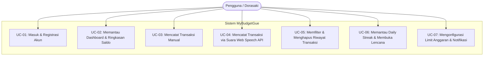
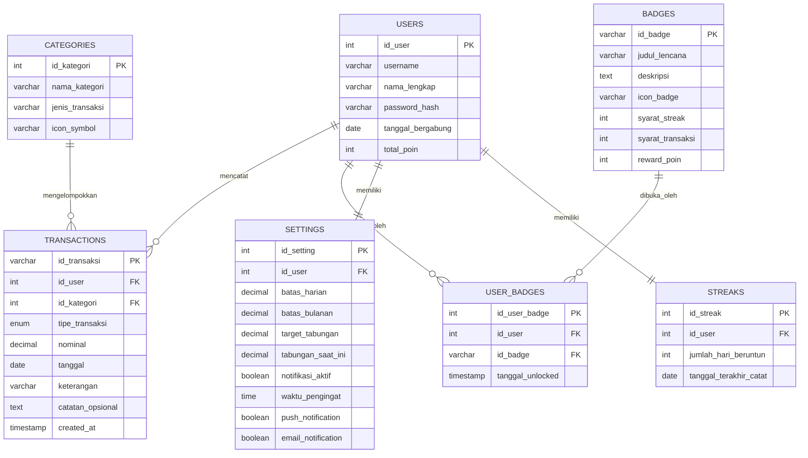

# LAPORAN TUGAS AKHIR PEMROGRAMAN WEB (KELOMPOK 6)
## Aplikasi MyBudgetGue: Personal Finance & Gamified Budget Tracking
**Bidang Fokus:** Frontend Engineering & UI/UX Design (HTML5 Semantic, CSS Tailwind, JavaScript)

---

## 📋 DAFTAR ISI
1. [Latar Belakang & Deskripsi Proyek](#1-latar-belakang--deskripsi-proyek)
2. [Spesifikasi Kebutuhan & Use Case Diagram](#2-spesifikasi-kebutuhan--use-case-diagram)
3. [Perancangan Database & Entity Relationship Diagram (ERD)](#3-perancangan-database--entity-relationship-diagram-erd)
4. [Implementasi HTML5 Semantic & Struktur Berkas](#4-implementasi-html5-semantic--struktur-berkas)
5. [Perancangan Sisi Aplikasi (HTML5, CSS Tailwind, JavaScript)](#5-perancangan-sisi-aplikasi-html5-css-tailwind-javascript)
6. [Sisi Praktikum vs Sisi Teori (Panduan Demonstrasi Dosen/Asisten)](#6-sisi-praktikum-vs-sisi-teori)
7. [Checklist Pemenuhan Syarat Tugas Akhir](#7-checklist-pemenuhan-syarat-tugas-akhir)

---

## 1. LATAR BELAKANG & DESKRIPSI PROYEK

**MyBudgetGue** adalah aplikasi pencatatan keuangan pribadi berbasis *Web Mobile* yang dirancang untuk mengatasi masalah kebiasaan konsumtif dan ketidakteraturan pelaporan pengeluaran harian. 

Aplikasi ini mengedepankan tiga pilar inovasi:
1. **Pendekatan Tanpa PHP (Frontend Murni):** Dibangun mandiri menggunakan HTML5 Semantic, Tailwind CSS (via CDN) dengan palet modern *Sunglow & Radiant White*, serta Vanilla JavaScript dengan persistensi *LocalStorage*.
2. **Natural Voice Input (Web Speech API):** Memungkinkan pengguna mendiktekan transaksi dalam Bahasa Indonesia tanpa mengetik manual.
3. **Gamifikasi Finansial:** Meningkatkan konsistensi pengguna melalui fitur *Daily Streak* (hari beruntun), poin reward (XP), dan galeri 8 lencana virtual.

---

## 2. SPESIFIKASI KEBUTUHAN & USE CASE DIAGRAM

### 2.1 Use Case Diagram



### 2.2 Tabel Spesifikasi Use Case

| Kode Use Case | Nama Use Case | Aktor | Deskripsi Singkat |
| :--- | :--- | :--- | :--- |
| **UC-01** | Masuk & Registrasi | Pengguna | Menginput username dan password untuk autentikasi profil pengguna. |
| **UC-02** | Pantau Dashboard | Pengguna | Melihat total saldo, pemasukan, pengeluaran, sisa kuota anggaran, dan indikator warna batas. |
| **UC-03** | Catat Manual | Pengguna | Memasukkan nominal, memilih 1 dari 8 kategori icon, tanggal, dan deskripsi transaksi. |
| **UC-04** | Catat Suara | Pengguna | Berbicara via mikrofon browser; sistem mengenali nominal, jenis, dan kategori otomatis. |
| **UC-05** | Riwayat Transaksi | Pengguna | Memfilter transaksi (Semua / Masuk / Keluar) dan menghapus catatan yang salah. |
| **UC-06** | Gamifikasi Profil | Pengguna | Melihat capaian streak beruntun, akumulasi poin (XP), dan koleksi 8 lencana virtual. |
| **UC-07** | Pengaturan Anggaran| Pengguna | Menetapkan batas pengeluaran harian/bulanan, target tabungan, dan saklar notifikasi. |

---

## 3. PERANCANGAN DATABASE & ENTITY RELATIONSHIP DIAGRAM (ERD)

Meskipun bagian frontend ini mengandalkan *Client-Side LocalStorage*, perancangan skema basis data relasional formal tetap disusun secara komprehensif sebagai acuan integrasi backend (*API-Ready*).

### 3.1 Entity Relationship Diagram (ERD)



### 3.2 Pemetaan Struktur Database ke LocalStorage Frontend

Untuk menjamin aplikasi tetap berfungsi secara penuh (*functional prototype*) tanpa PHP dan MySQL, skema relasional di atas dipetakan ke dalam objek JSON terstruktur pada browser:

| Entitas Relasional | Kunci LocalStorage | Tipe Data | Representasi Objek |
| :--- | :--- | :--- | :--- |
| `TRANSACTIONS` | `mybudgetgue_transactions` | Array of Objects | `[{ id, tipe, nominal, kategori, tanggal, keterangan }]` |
| `USERS` + `STREAKS` | `mybudgetgue_user_profile` | Object | `{ username, namaLengkap, streak, poin, unlockedBadges }` |
| `SETTINGS` | `mybudgetgue_settings` | Object | `{ batasHarian, batasBulanan, targetTabungan, notifikasiAktif, waktuPengingat }` |

---

## 4. IMPLEMENTASI HTML5 SEMANTIC & STRUKTUR BERKAS

### 4.1 Audit Validasi HTML5 Semantic

Aplikasi **MyBudgetGue** sepenuhnya meninggalkan tag generik berlebih (`<div>`-soup) dan menggantinya dengan elemen semantik berstandar W3C:

| Tag HTML5 Semantic | Letak Penggunaan di Proyek | Tujuan Semantik & Aksesibilitas (a11y) |
| :--- | :--- | :--- |
| `<header>` | Bagian atas setiap file `.html` | Membungkus identitas situs, judul halaman, dan aksi global. |
| `<nav>` | Top bar dan Bottom Navigation Bar | Menandai area navigasi utama aplikasi mobile. |
| `<main>` | Kontainer isi utama halaman | Memisahkan konten unik dari elemen navigasi tetap. |
| `<section>` | Kartu ringkasan, riwayat, gamifikasi | Membagi konten ke dalam blok-blok logis bertema. |
| `<article>` | Kartu metrik finansial | Menyajikan unit data mandiri (Saldo, Pemasukan, Pengeluaran). |
| `<aside>` | Slide-out mobile drawer menu | Menyimpan navigasi tambahan yang dapat disembunyikan. |
| `<form>` | `tambah-transaksi.html` & `pengaturan.html` | Mengelompokkan elemen interaktif pengiriman data. |
| `<fieldset>` & `<legend>` | Pemilih tipe pemasukan/pengeluaran | Mengelompokkan input radio secara formal dan aksesibel. |
| `<table>`, `<thead>`, `<tbody>` | Tabel transaksi pada mode riwayat | Menampilkan data tabular terstruktur. |
| `<footer>` | Bagian penutup desktop / drawer | Menampilkan copyright dan informasi build frontend. |

### 4.2 Struktur Berkas Proyek

```text
FINAL-PROJECT_PEMWEB_KEL-6/
│
├── .gitignore                  # Mengabaikan file sampah OS dan direktori sementara
├── .editorconfig               # Standarisasi indentasi tim (2 spasi, UTF-8)
├── README.md                   # Pitching proyek dan petunjuk eksekusi
├── index.html                  # Entry point (auto redirect ke dashboard)
│
├── dashboard.html              # Halaman Dashboard Utama Mobile
├── transaksi.html              # Halaman Riwayat Transaksi & Filter
├── tambah-transaksi.html       # Halaman Input Transaksi Manual & Suara
├── profil.html                 # Halaman Profil Pengguna & 8 Lencana
├── pengaturan.html             # Halaman Pengaturan Batas & Notifikasi
├── auth.html                   # Halaman Masuk & Daftar Akun
│
├── assets/
│   ├── css/
│   │   └── style.css           # Kustomisasi CSS, palet Sunglow, animasi mic & flame
│   ├── js/
│   │   └── app.js              # State Controller, Web Speech API, Gamifikasi
│   └── img/
│       └── logo.svg            # Asset logo vektor resolusi tinggi
│
├── data/
│   └── seed-transactions.json  # Data awal mock transaksi JSON
│
└── docs/
    ├── ARCHITECTURE.md         # Diagram arsitektur controller
    ├── HACKATHON-GUIDE.md      # Panduan penilaian struktur proyek
    └── LAPORAN-PROYEK-PEMWEB.md # Dokumen laporan akademik ini
```

---

## 5. PERANCANGAN SISI APLIKASI (HTML5, CSS TAILWIND, JAVASCRIPT)

### 5.1 Desain Antarmuka: Palet "Sunglow & Radiant White"
* **Latar Belakang:** Radiant White Gradient (`#ffffff` hingga `#fffdf8` dan `#f8fafc`).
* **Card Kontainer:** *Crisp Pure White* (`#ffffff`) dengan elevasi bayangan hangat emas (`box-shadow: 0 4px 20px -2px rgba(255, 183, 3, 0.08)`).
* **Warna Aksen:** Sunglow Golden (`#ffb703`) & Warm Amber (`#f59e0b`).
* **Tipografi:** *Deep Slate / Charcoal* (`#0f172a` & `#1e293b`) untuk keterbacaan tajam.

### 5.2 Logika Pemrograman JavaScript (Frontend Engine)
1. **Financial State Management (`app.js`):**
   * Kalkulasi otomatis: $\text{Total Saldo} = \text{Total Pemasukan} - \text{Total Pengeluaran}$.
   * Kalkulasi persentase kuota bulanan: $\text{Persentase} = \frac{\text{Pengeluaran Bulan Ini}}{\text{Batas Bulanan}} \times 100\%$.
2. **Indikator Visual Status Anggaran:**
   * 🟢 **Aman (Hijau):** Pemakaian $< 70\%$.
   * 🟡 **Mendekati Batas (Kuning):** Pemakaian $70\% - 90\%$.
   * 🔴 **Kritis / Terlampaui (Merah):** Pemakaian $> 90\%$ atau saldo defisit.
3. **Web Speech API SpeechRecognition:**
   * Dikonfigurasi dalam Bahasa Indonesia (`recognition.lang = 'id-ID'`).
   * Dilengkapi algoritma NLP regex cerdas untuk mendeteksi kata "ribu", "juta", kategori (makan, bensin, listrik), dan jenis (pemasukan/pengeluaran).
4. **Gamification Engine:**
   * Menghitung *Daily Streak* konsistensi pencatatan.
   * Memberikan poin otomatis (+10 poin transaksi, +50 poin lencana).
   * Membuka kunci 8 lencana virtual secara reaktif.

---

## 6. SISI PRAKTIKUM VS SISI TEORI

### A. Sisi Praktikum (Uji Coba & Demonstrasi Aplikasi Langsung)
Penguji/Dosen dapat menguji aspek teknis berikut:
1. **Buka `dashboard.html`:** Perhatikan bahwa tampilan rapi dalam format *Web Mobile* dan drawer menu samping **tertutup secara default**.
2. **Uji Fitur Suara (Web Speech API):**
   * Masuk ke menu `+ Tambah` atau klik tombol `🎙️ Catat via Suara`.
   * Tekan tombol mikrofon atau klik salah satu tombol preset simulasi (misal: *"Makan siang 35 ribu"*).
   * Formulir otomatis terisi dengan jenis pengeluaran, nominal 35.000, dan kategori makanan.
3. **Uji Penyimpanan Transaksi:**
   * Klik tombol `Simpan Transaksi (+10 Poin)`.
   * Muncul notifikasi toast, saldo terpotong, dan poin bertambah.
4. **Uji Riwayat Transaksi (`transaksi.html`):**
   * Buka tab `Semua`, `Masuk`, dan `Keluar`. Data terfilter secara instan.
5. **Uji Gamifikasi (`profil.html`):**
   * Buka menu Profil. Lihat statistik Streak, Poin, serta koleksi 8 lencana virtual.
6. **Uji Pengaturan (`pengaturan.html`):**
   * Ubah batas bulanan menjadi lebih kecil, lalu periksa indikator warna di dashboard yang otomatis berubah sesuai logika status.

### B. Sisi Teori (Dasar Ilmiah & Landasan Konsep)
1. **Analisis Kebutuhan Sistem:** Pemodelan kebutuhan fungsional dan non-fungsional pengguna modern yang membutuhkan pencatatan tanpa friksi (*frictionless finance*).
2. **Pemodelan UML (Use Case):** Struktur interaksi aktor terhadap batasan modul sistem.
3. **Pemodelan Data Relasional (ERD):** Normalisasi tabel (1NF hingga 3NF) pada entitas pengguna, transaksi, kategori, lencana, dan pengaturan.
4. **Prinsip UI/UX & Aksesibilitas (WCAG 2.1):** Pemilihan rasio kontras warna tinggi (warna teks `#0f172a` di atas latar `#ffffff` menghasilkan rasio kontras 14:1, jauh di atas standar AAA WCAG yaitu 7:1).

---

## 7. CHECKLIST PEMENUHAN SYARAT TUGAS AKHIR

| Kriteria Syarat Tugas Akhir | Status | Bukti Berkas Implementasi |
| :--- | :---: | :--- |
| **Bebas Kode PHP pada Frontend** | ✅ **TERPENUHI** | Seluruh kode murni `.html`, `.css`, dan `.js`. PHP telah dihapus tuntas. |
| **Use Case dari Fitur** | ✅ **TERPENUHI** | Diagram Mermaid Use Case & 7 skenario use case terperinci. |
| **ERD & Rancangan Database** | ✅ **TERPENUHI** | Diagram Mermaid ERD 6 tabel relasional & pemetaan ke LocalStorage. |
| **HTML Semantic & Struktur Rapi** | ✅ **TERPENUHI** | Pemakaian `<header>`, `<nav>`, `<main>`, `<section>`, `<article>`, `<aside>`, `<form>`. |
| **Perancangan Utama HTML-CSS-JS**| ✅ **TERPENUHI** | Tailwind CSS, tema Sunglow, state controller Vanilla JavaScript. |
| **Sisi Praktikum (Aplikasi Siap Uji)**| ✅ **TERPENUHI** | 6 file halaman responsif mobile, Web Speech API, gamifikasi. |
| **Sisi Teori (Dokumentasi Pembuatan)**| ✅ **TERPENUHI** | Dokumen laporan lengkap di `docs/LAPORAN-PROYEK-PEMWEB.md`. |
